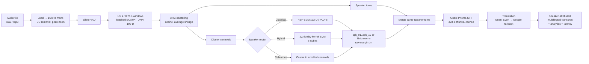

# EchoFlow-Q: Hybrid Quantum-Classical Speaker Identification and Multilingual Speech Processing for Group Discussions

**B.Tech CSE (AI) Capstone · Technical Report**
**Includes the Mathematics for Computing-3 (MFC-3) component: covariance, PCA, SVD, matrix norms, convex SVM duality and KKT conditions.**

Every number in this report is read from `results/metrics/*.json` / `*.csv`, which are produced by the scripts named next to each table. Nothing has been typed in by hand. Figures are in `results/figures/`.

---

## Abstract

EchoFlow-Q processes a recorded Kannada group discussion in four steps. It works out **who spoke when** (diarization), decides **who each voice is** from 10 enrolled speakers, rejecting voices it does not know, transcribes **what was said** with Gnani AI's Prisma speech recogniser, and **translates** each turn into English, Hindi, Tamil, Telugu or Kannada. Speaker identity uses frozen, pretrained ECAPA-TDNN embeddings (192-D). We compare a classical RBF-kernel SVM against a **hybrid quantum-classical SVM** whose kernel is the state fidelity $|\langle\phi(x_i)|\phi(x_j)\rangle|^2$ of a 6-qubit ZZ feature map, simulated exactly. Both are trained and tested on identical leak-free splits.

On held-out data the classical RBF kernel **matches or beats** the quantum kernel everywhere:

| Comparison | Classical RBF | Quantum ZZ (6 qubits) |
|---|---|---|
| Closed-set accuracy, k = 6 | 1.000 | 1.000 |
| Kernel-target alignment | **0.968** | 0.908 |
| Open-set AUROC (known vs unknown speakers) | **0.989** | 0.876 (Platt-calibrated) / 0.977 (raw decision values) |
| Few-shot AUROC, paired runs | wins **28 of 32** | wins 4 of 32 |
| Accuracy with 20 dB noise | 1.000 | 0.894 |
| Accuracy on 1 s clips | 0.851 | 0.574 |

We trace the gap to **exponential concentration of the fidelity kernel** and to the **6-dimensional PCA bottleneck**.

The full system achieves:

- **Diarization error rate (DER):** 16.7% on synthetic test meetings and 38.3% on real Kannada meetings (16.6% when overlapped speech is excluded).
- **Speech recognition:** 38.2% word error rate (WER) and 11.3% character error rate (CER) on held-out Kannada.
- **Unknown speakers:** zero false acceptance of the 55 clusters from real, never-enrolled meeting participants (classical routers).
- **Speed:** about 0.11× real time for a 47 s meeting once translations are cached.

---

## 1. Objectives

1. Separate *who spoke when* (diarization) from *who the speaker is* (identification). The two are deliberately decoupled.
2. Identify 10 enrolled speakers and **never force an unknown voice into one of the 10 classes** (open-set rejection).
3. Run the MFC-3 linear-algebra pipeline from first principles and verify every step numerically against reference libraries.
4. Run a **fair, leak-free** classical-vs-quantum kernel comparison, including stress tests where the classical baseline is not already at 100%.
5. Produce speaker-attributed Kannada transcripts and translations through the Gnani AI API, and deliver everything in a usable web UI.

---

## 2. System architecture

**Branch A** (diarization and speaker identification) and **Branch B** (speech recognition and translation) meet only through segment timestamps. Either branch can be replaced without touching the other.

| Layer | Implementation |
|---|---|
| Data | `src/data/` (streamed Hugging Face slices, curation, splits) |
| Pre-processing | `src/preprocessing/` (loader, cleaning, Silero VAD, segmentation) |
| Features + MFC-3 | `src/features/` (MFCC, ECAPA, z-score, covariance, PCA, SVD) |
| Models | `src/models/` (classical SVM with KKT verification, quantum SVM, training runners) |
| Quantum | `src/quantum/` (feature maps, fidelity kernel, kernel-target alignment) |
| Diarization | `src/diarization/` (windowed embedder, AHC, router, evaluation) |
| Speech | `src/speech/` (Gnani client, ASR, translation with cache and fallback) |
| Product | `src/pipeline/echoflow_pipeline.py`, `app/streamlit_app.py` |

---

## 3. Data and evaluation protocol

### 3.1 Datasets (streamed slices only; no full downloads)
| Dataset | Use | What was taken |
|---|---|---|
| `ai4bharat/IndicVoices`, `kannada/valid` (425 MB of a 39 GB language) | Enrollment and identification | 10 speakers (5 female, 5 male), 22–30 clips each, 2–15 s: **278 clips, 37.5 min**. Plus 5 *unknown* speakers × 10 clips |
| `sarvamai/indic-diarbench`, `Kannada/test` | Real-meeting diarization | 4 near-field recordings (13.4 min; 4–6 speakers; 17–40% overlapped speech) |

All field names were confirmed with inspection scripts before use (`src/data/inspect_*.py`).

### 3.2 Leakage controls
- **Splits:** 70/15/15 train/val/test, with a fixed seed of 42. In `valid`, each speaker has a single recording, so each speaker's chunks are ordered by chunk index and cut into **contiguous, non-interleaved time blocks**. Verified: 0 overlap between splits on clip ID, file path and MD5 audio hash; all 10 speakers appear in every split.
- **Fitting:** the z-score scaler, PCA and the quantum angle scaler are fit on **train only**. All hyper-parameters are chosen on **val only**, and test is scored once.
- **Unknown speakers:** split **by speaker**. `unk_01` and `unk_02` are used only to calibrate thresholds; `unk_03` to `unk_05` are used only for reporting.
- **Diarization:** the clustering threshold and router thresholds are tuned on 5 *validation* mixtures (val clips plus calibration unknowns). The 5 *test* mixtures use only test clips and `unk_03` to `unk_05`.

### 3.3 Known limitation: one session per speaker
Train and test clips for a speaker come from the **same recording session**, so they share the same microphone and room. Closed-set accuracy is therefore optimistic. This is why the quantum comparison relies on harder conditions: low dimension, few-shot enrollment, open-set rejection, noise and short clips.

---

## 4. Signal processing and features

- **Pre-processing:** DC removal, then Silero VAD (threshold 0.5, minimum speech 0.25 s, minimum silence 0.15 s), leading/trailing-silence trim, then peak normalisation applied *after* VAD so noise is not amplified. All 278 + 50 clips produced a non-empty segment (one quiet back-channel clip fell back to the full clip).
- **MFCC baseline (120-D):** 25 ms Hann window with 10 ms hop, then the power spectrum, a 40-band Mel filterbank, log energies, and a DCT-II. We keep 20 coefficients plus their first and second differences (Δ and ΔΔ), giving 60 values per frame, and summarise each with its mean and standard deviation over time.
- **ECAPA-TDNN (192-D):** `speechbrain/spkrec-ecapa-voxceleb`, frozen, L2-normalised.

**Hypersphere geometry.** For unit vectors, $\|x-y\|_2^2 = 2 - 2\cos\theta_{xy}$, so Euclidean distance and cosine similarity carry the same information about ECAPA embeddings. As a sanity check, the mean cosine similarity on train is **0.784 for the same speaker and 0.249 for different speakers**. (After z-scoring, the RBF kernel is no longer an exact function of cosine, because each dimension is rescaled.)

---

## 5. MFC-3 mathematics (verified numerically)

Runner: `src/features/run_mfc3_analysis.py`, which writes `results/metrics/mfc3_summary.json`. Data: the z-scored ECAPA train matrix $X \in \mathbb{R}^{184\times192}$.

### 5.1 Standardisation
$X_{\text{std}} = (X-\mu)/\sigma$ with $\mu, \sigma$ estimated on train only. Train comes out with mean 0 and standard deviation 1, while val does not (its largest column mean is 0.40–0.50), which confirms the scaler was not refit on val.

### 5.2 Covariance $C = \tfrac{1}{n-1}X_c^\top X_c$
| Quantity | Value | Identity verified |
|---|---|---|
| $\operatorname{tr}(C)$ (total variance) | 193.05 | $= \sum_i \lambda_i$, and $= d\cdot\tfrac{n}{n-1}$ for z-scored data |
| $\lVert C\rVert_F$ | 49.19 | $= \sqrt{\sum_i\lambda_i^2}$ |
| $\lVert C\rVert_2$ | 27.62 | $= \lambda_{\max}$ |
| rank$(C)$ | **183 / 192** | $\le n-1$ because centring uses one degree of freedom, and $n < d$ |
| Condition number (non-zero eigenvalues) | $1.7\times10^5$ | — |
| Mean off-diagonal $\lvert r\rvert$ | 0.200 (ECAPA) vs 0.193 (MFCC) | Share of feature pairs with $\lvert r\rvert>0.5$: 3.4% (ECAPA) vs 10.4% (MFCC) |

$C$ matches `np.cov`, is symmetric, and is positive semi-definite. **Covariance is rank-deficient whenever $n \le d$**, which is why PCA is a practical necessity here, not just a convenience.

### 5.3 PCA by eigendecomposition: $Cv_i=\lambda_i v_i$, $Z = X_cW_k$
Implemented with `np.linalg.eigh` (C is symmetric, so the eigenvalues are real and the eigenvectors orthonormal). Checks against `sklearn.decomposition.PCA`: the eigenvalues are equal; $|\langle v_i, v_i^{sk}\rangle| = 1$, so the components agree up to sign; $W^\top W = I$; and $\operatorname{cov}(Z_{\text{train}}) = \operatorname{diag}(\lambda)$.

| k | 2 | 4 | 6 | 8 | 16 | 32 | 64 |
|---|---|---|---|---|---|---|---|
| Variance retained | 24.6% | 42.8% | 56.7% | 66.4% | 76.3% | 85.5% | 94.4% |

Figures: `pca_explained_variance.png`, and `pca_2d_speakers.png` (small multiples, one panel per speaker). In just two dimensions, nine of the ten speakers form their own cluster; spk_02 and spk_04 overlap.

### 5.4 SVD: $X_c = U\Sigma V^\top$
- **Link to PCA:** $\lambda_i = \sigma_i^2/(n-1)$ holds exactly, and $V$ equals the PCA eigenvectors up to sign.
- **Spectrum:** $\sigma_1 = 71.09$, smallest non-zero $\sigma = 0.174$, numerical rank 183.
- **Best low-rank approximation (Eckart–Young):** $\lVert X_c - U_k\Sigma_kV_k^\top\rVert_F = \sqrt{\sum_{i>k}\sigma_i^2}$, verified for every k. Relative error: 86.8% (k=2), 65.8% (k=6), 23.6% (k=64).
- **Norms:** $\lVert X_c\rVert_F=\sqrt{\sum\sigma_i^2}$ and $\lVert X_c\rVert_2=\sigma_1$.

All 20 numerical checks pass (`mfc3_summary.json → checks`).

### 5.5 Convex optimisation, Lagrange multipliers and KKT conditions (soft-margin SVM)
The primal problem is $\min_{w,b,\xi}\tfrac12\lVert w\rVert^2 + C\sum\xi_i$ subject to $y_i(w^\top\phi(x_i)+b)\ge1-\xi_i$ and $\xi_i\ge0$. It is a convex quadratic programme, and Slater's condition holds, so strong duality applies. Setting the gradient of the Lagrangian to zero gives $w=\sum\alpha_iy_i\phi(x_i)$, $\sum\alpha_iy_i=0$ and $0\le\alpha_i\le C$. The dual problem is

$$\max_\alpha \sum_i\alpha_i-\tfrac12\sum_{i,j}\alpha_i\alpha_jy_iy_jK(x_i,x_j)\quad \text{s.t.}\ 0\le\alpha_i\le C,\ \sum_i\alpha_iy_i=0,$$

which is concave because $K$ is positive semi-definite. **Complementary slackness** then says: $\alpha_i=0 \Rightarrow y_if(x_i)\ge1$; $0<\alpha_i<C \Rightarrow y_if(x_i)=1$ (free support vectors lie exactly on the margin); $\alpha_i=C \Rightarrow y_if(x_i)\le1$.

`kkt_report()` recovers all **45 one-vs-one binary duals** from the trained libsvm model and checks each condition. For the ECAPA-192 model: box constraint 0/1638 violations, $\sum\alpha y=0$ 0/45, free SVs on the margin 0/343, bounded SVs inside the margin 0/890, non-SVs outside the margin 0/423. The Gram matrix is PSD with $\lambda_{\min}=1.97\times10^{-3}$. **The KKT conditions also hold for all 9 classical and 8 quantum SVMs.**

---

## 6. Classical baselines (Stage 6)
Source: `classical_results.csv`. Test set: 47 clips from 10 speakers. Open-set scores use 30 clips from the never-seen speakers `unk_03` to `unk_05`.

| Model | C | Accuracy | Macro-F1 | CCR | TRR | FAR | AUROC | #SV |
|---|---|---|---|---|---|---|---|---|
| RBF-SVM · MFCC (120-D) | 1 | 1.000 | 1.000 | 0.766 | 0.833 | 0.167 | 0.884 | 167 |
| RBF-SVM · ECAPA (192-D) | 1 | 1.000 | 1.000 | 0.872 | **1.000** | **0.000** | 0.988 | 182 |
| RBF-SVM · PCA-ECAPA k=2 | 1 | 0.957 | 0.955 | 0.702 | 0.533 | 0.467 | 0.802 | 148 |
| RBF-SVM · PCA-ECAPA k=4 | 0.1 | 0.979 | 0.980 | 0.723 | 1.000 | 0.000 | 0.978 | 162 |
| RBF-SVM · PCA-ECAPA k=6 | 0.1 | 1.000 | 1.000 | **0.957** | 1.000 | 0.000 | **0.989** | 152 |
| RBF-SVM · PCA-ECAPA k=8 | 0.1 | 1.000 | 1.000 | 0.894 | 1.000 | 0.000 | 0.989 | 177 |

CCR is the share of known clips both accepted and correctly identified; TRR is the share of unknown clips rejected; FAR = 1 − TRR. The rejection threshold uses Platt-calibrated maximum posterior, with τ tuned on val plus `unk_01` and `unk_02`.

**Takeaways.**
- **Closed-set accuracy has hit its ceiling** (the single-session effect from §3.3). Open-set rejection is where models differ.
- **ECAPA rejects unknown voices far better than MFCC:** FAR 0.000 against 0.167.

---

## 7. Hybrid quantum-classical kernel (Stage 7)

### 7.1 Feature map and angle scaling
The ZZ feature map (Havlíček et al., 2019) has 2 repetitions and full entanglement: $|\phi(x)\rangle = \left(U_\Phi(x)H^{\otimes k}\right)^2|0\rangle^{\otimes k}$, where $U_\Phi(x)=\exp\!\big(i\sum_j x_jZ_j + i\sum_{j<l}(\pi-x_j)(\pi-x_l)Z_jZ_l\big)$.

The angles are computed as $x_j = \alpha\,\pi\tanh(z_j/\sigma_j)$, with $\sigma_j$ estimated on train only. The tanh keeps every angle inside $(-\alpha\pi,\alpha\pi)$, which avoids $2\pi$ wrap-around, and the bandwidth $\alpha$ is tuned on val.

| Circuit (gates decomposed to H, P and CX) | k=2 | k=4 | k=6 | k=8 |
|---|---|---|---|---|
| ZZ map: depth / CX count | 10 / 4 | 31 / 24 | 49 / 60 | 67 / 112 |
| Z map (no entanglement): depth / CX count | 4 / 0 | 4 / 0 | 4 / 0 | 4 / 0 |

### 7.2 The fidelity kernel is a valid kernel in a reproducing-kernel Hilbert space
$K_Q(x,x')=|\langle\phi(x)|\phi(x')\rangle|^2=\operatorname{Tr}[\rho(x)\rho(x')]$, with $\rho=|\phi\rangle\langle\phi|$. This is a Hilbert–Schmidt inner product of density matrices, so $K_Q$ is symmetric and positive semi-definite with $K_Q(x,x)=1$. The dual problem therefore stays convex. All of these properties hold numerically for every quantum Gram matrix.

**Implementation:** each statevector is simulated once, giving a matrix $\Psi\in\mathbb{C}^{n\times2^k}$, and then $K=|\Psi_A\Psi_B^\dagger|^{\circ2}$ (elementwise squared magnitude). This matches Qiskit's `FidelityStatevectorKernel` to within **8.0e-15** and is faster (2.54 s vs 2.92 s for the 184×184 matrix in the saved run).

### 7.3 Kernel-target alignment (KTA) and kernel concentration
$\mathrm{KTA}(K,y)=\langle K_c,L_c\rangle_F/(\lVert K_c\rVert_F\lVert L_c\rVert_F)$, where $L=YY^\top$ marks same-speaker pairs and $K_c=HKH$ is the centred kernel. A value of 1 means the kernel's similarity structure matches speaker identity perfectly.

| Train-set KTA at the val-selected setting | k=2 | k=4 | k=6 | k=8 |
|---|---|---|---|---|
| Classical RBF | **0.613** | **0.886** | **0.968** | **0.957** |
| Quantum ZZ | 0.497 | 0.765 | 0.908 | 0.913 |
| Quantum Z (no entanglement) | 0.575 | 0.738 | 0.850 | 0.908 |

**Bandwidth sweep (ZZ, k=6):**

| α | 0.01 | 0.02 | 0.05 | 0.1 | 0.2 | 0.5 | 1.0 |
|---|---|---|---|---|---|---|---|
| KTA | 0.509 | 0.734 | **0.908** | 0.753 | 0.518 | 0.267 | 0.223 |

At large α the mean off-diagonal kernel value falls to about $1/2^k$. At α = 1 and k = 6 it is ≈ 0.016, against $1/64 = 0.0156$. That is the value expected for random states in a $2^k$-dimensional Hilbert space: **exponential concentration**, where every pair of speakers looks equally dissimilar. The optimum α shrinks as k grows (0.1 for k=2, 0.05 for k=4 and 6, 0.02 for k=8), so the usable region of the feature map gets narrower with more qubits. Figure: `kernel_gram_comparison.png`.

### 7.4 Experiment A: full training set (identical PCA-ECAPA splits)
Source: `classical_vs_quantum.csv`.

| Model | Accuracy | Macro-F1 | CCR | TRR | FAR | AUROC | #SV | Gram time (s) | ms per clip |
|---|---|---|---|---|---|---|---|---|---|
| Classical RBF k=4 | 0.979 | 0.980 | 0.723 | 1.000 | 0.000 | **0.978** | 162 | 0.002 | 0.04 |
| Quantum ZZ k=4 | 0.979 | 0.980 | 0.681 | 1.000 | 0.000 | 0.946 | 105 | 1.16 | 6.3 |
| Classical RBF k=6 | 1.000 | 1.000 | **0.957** | 1.000 | 0.000 | **0.989** | 152 | 0.002 | 0.08 |
| Quantum ZZ k=6 | 1.000 | 1.000 | 0.830 | 0.800 | 0.200 | 0.876 | 172 | 3.10 | 16.3 |
| Quantum Z k=6 | 1.000 | 1.000 | 0.936 | 1.000 | 0.000 | 0.988 | 131 | 0.63 | 2.0 |
| Classical RBF k=8 | 1.000 | 1.000 | 0.894 | 1.000 | 0.000 | **0.989** | 177 | 0.001 | 0.03 |
| Quantum ZZ k=8 | 0.979 | 0.980 | 0.936 | 0.767 | 0.233 | 0.839 | 176 | 1.11 | 6.1 |

Timings are from the saved run on a laptop CPU under the Windows "Balanced" power plan. Absolute values varied by up to about 5× between runs, but classical was always about 1000× faster. The quantum cost is classical *simulation* of $2^k$ amplitudes.

### 7.5 Experiment B: few-shot stress test (5 seeds; val re-tuned for every subset)
Source: `quantum_results.json → experiment_B_*`. Figure: `few_shot_classical_vs_quantum.png`.

| k | Clips per speaker (N) | Macro-F1, RBF / Quantum | AUROC, RBF / Quantum | Quantum wins / losses on AUROC |
|---|---|---|---|---|
| 4 | 3 | 0.983 / 0.976 | **0.984** / 0.941 | 1 / 4 |
| 4 | 5 | 0.971 / 0.971 | **0.992** / 0.929 | 0 / 5 |
| 4 | 10 | 0.980 / 0.980 | **0.993** / 0.953 | 0 / 5 |
| 6 | 3 | 1.000 / 0.996 | **0.987** / 0.974 | 0 / 5 |
| 6 | 5 | 0.996 / 0.996 | **0.987** / 0.971 | 0 / 5 |
| 6 | 10 | 1.000 / 1.000 | **0.986** / 0.977 | 3 / 2 |

Even with only 3 clips per speaker, ECAPA embeddings separate the speakers well enough that both kernels reach a macro-F1 of 0.97 or more. The kernel choice only shows up in open-set rejection, where **classical wins 28 of 32 paired runs**.

### 7.6 Platt calibration distorts quantum confidence
For Quantum ZZ at k=6 on the full training set, AUROC is **0.876** when scored on Platt-calibrated probabilities (Experiment A) but **0.977** when scored on raw decision values (Experiment B). Platt scaling fits a sigmoid on internal cross-validation folds, and that sigmoid fits badly on the concentrated quantum Gram matrix. **All deployed routing therefore uses raw decision margins.**

---

## 8. Diarization and speaker routing (Stage 8)
Method: 1.5 s windows with a 0.75 s hop, batched ECAPA, and agglomerative clustering (cosine distance, average linkage). Speaker count is set by a distance threshold or the silhouette score, chosen on val. The selected configuration is **threshold 0.75 with no small-cluster merging**. Each cluster's centroid is then routed to an enrolled speaker using a raw score threshold τ tuned on the val mixtures. Error rates use `pyannote.metrics` with a 0.25 s collar.

### 8.1 Track A: synthetic group discussions (5 test mixtures, 3–4 enrolled speakers + 1 unknown each, about 49 s each)
| Clustering | DER | Missed speech | False alarm | Confusion | Estimated speakers (true 4, 5, 4, 5, 4) |
|---|---|---|---|---|---|
| **Selected on val:** threshold 0.75 | **16.7%** | 7.7 | 0.0 | 9.0 | 8, 3, 4, 10, 4 |
| Silhouette (not selected) | 11.9% | 7.7 | 0.0 | 4.2 | — |
| True speaker count given | 15.9% | 7.7 | 0.0 | 8.2 | — |

| Router | τ | Clusters routed correctly | Unknown rejected | Known wrongly rejected | Wrong enrolled ID | Identification error (time-weighted) |
|---|---|---|---|---|---|---|
| **Cosine** | 0.689 | 0.586 | **1.000** | 0.440 | 0.040 | **0.171** |
| RBF-SVM 192-D | 9.292 | 0.552 | 1.000 | 0.520 | 0.000 | 0.236 |
| RBF-SVM PCA-6 | 9.290 | 0.586 | 1.000 | 0.480 | 0.000 | 0.201 |
| Quantum ZZ k=6 | 9.240 | 0.655 | 0.500 | 0.320 | 0.000 | 0.311 |

(29 test clusters, 4 of them unknown speakers.)

### 8.2 Track B: real Kannada meetings (sarvamai/indic-diarbench, 4 recordings, 13.4 min)
| Variant | DER | Missed speech | False alarm | Confusion |
|---|---|---|---|---|
| Selected configuration | 38.3% | 24.3 | 0.0 | 14.0 |
| **Overlapped speech excluded** | **16.6%** | 4.3 | 0.1 | 12.2 |
| True speaker count given | 40.0% | 24.3 | 0.0 | 15.6 |

None of these speakers is enrolled, so every cluster should be rejected. Clusters wrongly accepted as an enrolled speaker: **0 of 55 for cosine, RBF-192 and RBF-PCA6; 7% for Quantum ZZ.**

### 8.3 Interpretation
- **Missed speech on real meetings is overlap.** 17–40% of each recording is overlapped, and the system assigns one speaker at a time.
- **Confusion comes from over-clustering.** The diarizer estimated 7–19 speakers against a true 4–6, splitting real speakers into small fragments. Their noisy centroids then get rejected, which is the main cause of the high rate of wrongly rejected known speakers. The timeline figure `diarization_timeline.png` shows spk_08's first turn broken into six small clusters.
- **The validation mixtures were too easy to select a configuration.** Many settings tie at 4.7% DER on val. Silhouette clustering would have scored 11.9% on test, but by protocol it could not be chosen after seeing the test result.

---

## 9. Speech recognition and translation (Stage 9)
- **Speech recognition:** Gnani Prisma `prisma-v3.0`, `POST /stt/v3`, header `X-API-Key-ID` (the key is kept in `.env` and never logged). Verified response schema: `{success, request_id, transcript, model, processing_time, end_to_end_latency, detected_language_code}`. Turns longer than 28 s are split into chunks, since the REST limit is 30 s.
- **Benchmark:** 15 held-out test clips covering all 10 speakers (2.2 min of audio).

| WER | CER | WER without normalisation | Mean round trip | Server time | Speed | Detected language |
|---|---|---|---|---|---|---|
| **38.2%** | **11.3%** | 51.6% | 755 ms | 427 ms | 0.084× real time | kn-IN (15/15) |

**CER is the better measure for Kannada.** Kannada joins words together, so a single wrong suffix makes the whole word wrong. For example, `ಸ್ಕಿಲ್ಡ್ ಟೀಚರ್ಸ್ಗಳ್ನೆ` vs `ಸ್ಕಿಲ್ಡು ಟೀಚರ್ಸ್ಗಳನ್ನೇ` counts as 2 word errors but only a few character errors.

- **Translation:** Gnani Evon `evon-v3.5` at temperature 0 with a strict translation-only system prompt. **Both project keys returned HTTP 403 `SCOPE_NOT_ALLOWED` (no LLM scope)**, so the translator automatically falls back. It first tries `deep-translator`, which Google blocks from this network with HTTP 429, then Google's public JSON endpoint. Results are cached by (text hash, target language, backend). Once a key with the LLM scope is configured, Gnani is used again and preferred over any cached Google result.
- **Meeting-level WER is not valid here** (52.5% on `test_mix01`). 4 of the 7 reference turns were cut at 8 s when the mixtures were built, but their reference text still covers the full clip, so the cut-off words count as errors.

---

## 10. Robustness (Stage 12)
Source: `robustness_results.json`; figure `robustness_curves.png`. Each degraded test clip (47 known, 30 unknown) was re-embedded and scored by every saved model through its deployment transforms. Values are closed-set accuracy / open-set AUROC.

| Condition | Cosine (192-D) | RBF-SVM 192-D | RBF-SVM PCA-6 | Quantum ZZ 6 qubits |
|---|---|---|---|---|
| Clean | 1.000 / 0.982 | 1.000 / 0.988 | 1.000 / 0.992 | 1.000 / 0.977 |
| 20 dB SNR | 1.000 / 0.971 | 1.000 / 0.990 | 1.000 / 0.989 | **0.894** / 0.962 |
| 10 dB | 1.000 / 0.967 | 1.000 / 0.979 | 0.979 / 0.971 | 0.872 / 0.962 |
| 5 dB | 1.000 / 0.951 | 1.000 / 0.965 | 0.915 / 0.937 | 0.851 / 0.937 |
| 0 dB | 0.979 / 0.924 | **1.000 / 0.949** | 0.851 / 0.899 | 0.745 / 0.896 |
| First 1 s only | 0.979 / 0.879 | 0.936 / 0.927 | 0.851 / 0.919 | **0.574** / 0.802 |
| First 2 s | 1.000 / 0.972 | 1.000 / 0.991 | 0.979 / 0.981 | 0.851 / 0.898 |
| First 3 s | 1.000 / 0.982 | 1.000 / 0.992 | 1.000 / 0.995 | 0.957 / 0.950 |
| First 5 s | 1.000 / 0.983 | 1.000 / 0.988 | 1.000 / 0.991 | 1.000 / 0.961 |

Clips shorter than a cut were used whole: 1 known clip at 2 s; 1 known and 7 unknown at 3 s; 3 known and 11 unknown at 5 s. **Minimum duration for reliable identification** (accuracy ≥ 0.95 and AUROC ≥ 0.95): **2 s** for all classical models and **3 s** for the quantum kernel.

**Interpretation.**
- **The 192-D RBF model is the most robust** (still 1.000 accuracy at 0 dB).
- **Going down to PCA-6 costs robustness on its own** (0.851 at 0 dB): the bottleneck discards 43% of the variance.
- **The quantum kernel on the same 6 features loses accuracy fastest** (0.894 already at 20 dB). This fits the concentration picture in §7.3: the kernel only works in a narrow band of small α, where similarities change sharply with small shifts in the embedding. We have not isolated this cause experimentally; it is a hypothesis.

---

## 11. Integrated system and UI (Stages 10–11)
- **`EchoFlowPipeline.run(audio, target_language, classifier, asr_language)`** returns segment records with `segment_id`, `start_sec`, `end_sec`, `duration_sec`, `speaker_id`, `confidence_margin`, `detected_language`, `transcript` and `translation`. It also returns per-speaker talk-time analytics and the time spent in each stage. Unknown voices are kept apart as `Unknown-1`, `Unknown-2`, … rather than merged into one "Unknown".
- **Streamlit UI** (`app/streamlit_app.py`):
  - Audio sources: test meetings, DiarBench recordings, or upload.
  - Choice of classifier and target language.
  - Audio player, who-spoke-when timeline, speaker cards and a colour-coded transcript.
  - JSON/CSV export and a latency breakdown.
  - An analytics tab that reads every benchmark table and figure from `results/`.
- **Integration test** (`src/pipeline/test_end_to_end.py`): **21/21 checks pass.** On `test_mix01`, speaker identity is correct for **78.5%** of speech time with RBF-192 (5.4 s total, speech recognition served from cache) and **80.6%** with Quantum ZZ (14.2 s, mostly translation). The headless app test (Streamlit `AppTest`) renders the page and completes a full Run with 0 exceptions.

---

## 12. Discussion: why classical RBF beats the quantum ZZ kernel here
1. **Exponential concentration.** Fidelity between random $k$-qubit states averages $2^{-k}$. Unless the angles are kept small (small α), the off-diagonal kernel entries collapse and KTA falls (0.91 → 0.22 for k=6). Keeping α small enough to avoid this makes the kernel nearly flat and sensitive to small perturbations, which is what the noise and duration curves show.
2. **The PCA bottleneck.** The qubit budget forces k ≤ 8 PCA features (66% of the variance at most), while the RBF model can use all 192 dimensions. Even on identical PCA-6 inputs, RBF has the higher KTA (0.968 vs 0.908).
3. **A fixed feature map with no matching inductive bias.** The ZZ map's $(\pi-x_j)(\pi-x_l)$ phase structure has nothing to do with the geometry of speaker embeddings. RBF's Euclidean, distance-based similarity does: on the unit hypersphere it is closely related to the cosine scoring ECAPA was trained with.
4. **Entanglement adds no measurable value.** The entanglement-free Z map (a product state, efficiently simulable classically) matches or beats ZZ on open-set at k=6 and k=8.
5. **Cost.** Simulating $2^k$ amplitudes is exponential. On hardware, each kernel entry would be estimated from repeated measurements, adding shot noise on top of the concentration problem.

These results are consistent with the quantum machine learning literature on kernel concentration and bandwidth (e.g. Thanasilp et al., 2022; Shaydulin & Wild, 2022). They are a negative result for this task, obtained under a fair protocol, and not a failure of the implementation: every kernel property, KKT condition and equivalence check passes.

---

## 13. Limitations
- Train and test share a recording session per speaker (§3.3), so closed-set accuracy is optimistic.
- Diarization does not handle overlapping speech (24 percentage points of missed speech on DiarBench). It also over-clusters, and the validation mixtures were too easy to select a configuration reliably.
- Synthetic meetings have no overlap, use clips capped at 8 s (which invalidates meeting-level WER) and add synthetic noise only.
- Gnani Evon translation was not available on the project keys (403); the reported translations come from the Google fallback.
- Quantum results come from noiseless exact simulation; hardware noise and measurement shot noise are not modelled.
- Sample sizes are small: 47 test clips, 30 unknown clips, 5 mixtures, 4 real meetings. Differences of one or two clips are within noise.

## 14. Future work
- **Trainable quantum feature maps:** optimise the circuit parameters for kernel-target alignment, or use data re-uploading or projected quantum kernels, which avoid fidelity concentration. Also try bandwidth-scaled, hardware-efficient maps on more than 6 PCA features.
- **Overlap-aware diarization** (e.g. pyannote segmentation-3.0 with an overlapped-speech detector), and AHC followed by re-segmentation that merges small clusters, tuned on harder, more numerous validation mixtures.
- **Multi-session enrollment** from IndicVoices `train`, to measure cross-session generalisation.
- **Score-level fusion** of cosine and RBF routers, and adaptive per-speaker thresholds.
- **Gnani Evon translation** once the LLM scope is enabled, with BLEU/chrF evaluation against human references.

## 15. Reproducibility
Run from the project root with `.venv\Scripts\python.exe -m <module>`:

| Stage | Module | Output |
|---|---|---|
| 2 | `src.data.dataset_loader`, `src.data.dataset_split` | curated clips, `splits.csv` |
| 3 | `src.preprocessing.segmentation` | `vad_segments.csv` |
| 4 | `src.features.extract_all` | `data/processed/features/*.npz` |
| 5 | `src.features.run_mfc3_analysis` | `mfc3_summary.json`, PCA/SVD figures |
| 6 | `src.models.train_classical` | `classical_results.*`, confusion matrices |
| 7 | `src.models.train_quantum` | `quantum_results.json`, `classical_vs_quantum.csv` |
| 8 | `src.diarization.evaluate_diarization` | `diarization_results.json` |
| 9 | `src.speech.evaluate_asr_translation [--skip-benchmark]` | `asr_translation_results.json` |
| 10 | `src.pipeline.test_end_to_end` | `end_to_end_test.json` |
| 12 | `src.evaluation.robustness` | `robustness_results.json`, `robustness_curves.png` |

Seeds are fixed at 42 throughout.

**Engineering note:** `silero_vad` calls `torch.set_num_threads(1)` when it is imported, which silently made every later ECAPA call single-threaded, about 3–6× slower. `src/preprocessing/vad.py` saves and restores the thread count around that import.

### References
- Desplanques, Thienpondt & Demuynck (2020). *ECAPA-TDNN*. Interspeech.
- Havlíček et al. (2019). *Supervised learning with quantum-enhanced feature spaces*. Nature 567.
- Cortes, Mohri & Rostamizadeh (2012). *Algorithms for learning kernels based on centered alignment*. JMLR.
- Thanasilp, Wang, Cerezo & Holmes (2022). *Exponential concentration in quantum kernel methods*. arXiv:2208.11060.
- Shaydulin & Wild (2022). *Importance of kernel bandwidth in quantum machine learning*. Phys. Rev. A 106.
- Javadi-Abhari et al. (2024). *Quantum computing with Qiskit*. arXiv:2405.08810.
- Bredin (2017). *pyannote.metrics: a toolkit for reproducible evaluation, diagnostic, and error analysis of speaker diarization systems*. Interspeech.
- AI4Bharat, *IndicVoices* (2024); Sarvam AI, *indic-diarbench*.
